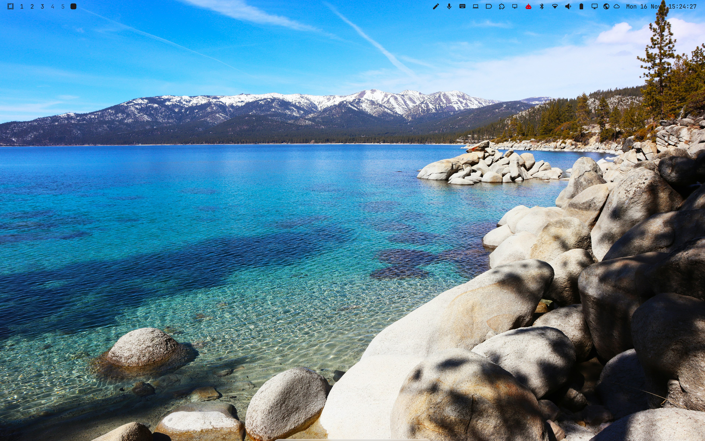

# Tahoe Light

A light theme for [Omarchy](https://omarchy.org), inspired by the look of macOS Tahoe.



## Install

```bash
omarchy-theme-install https://github.com/MateuszBrankiewicz/omarchy-tahoe-light-theme
```

Or open the Omarchy menu → **Install → Style → Theme** and paste the URL above.

Also available: [Tahoe (dark)](https://github.com/MateuszBrankiewicz/omarchy-tahoe-theme).

## Wallpaper credits

Photos from [Unsplash](https://unsplash.com), used under the [Unsplash License](https://unsplash.com/license):

- `1-tahoe-day.jpg`: Peter Hulce ([source](https://unsplash.com/photos/nNCdDwX-lBY))
- `2-tahoe-cascade.jpg`: Jeremy Doddridge ([source](https://unsplash.com/photos/efhEncQLi4w))
